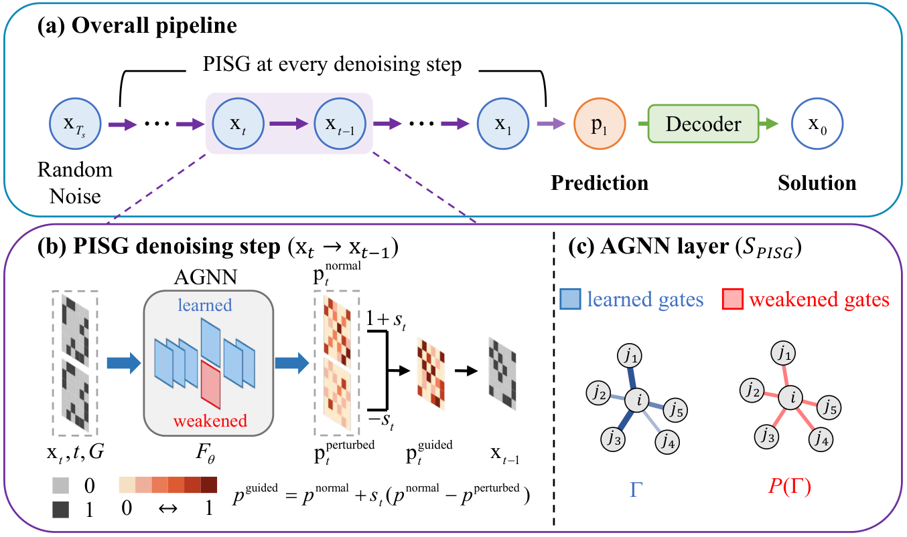

# PISG: Perturbed Instance-Structure Guidance

PISG adds inference-time guidance to diffusion and consistency solvers for the traveling salesman problem (TSP) and maximum independent set (MIS). This repository contains the implementations and selected reproduction scripts for **PISG: Constraint-Aligned Signal Amplification for Diffusion-Based Combinatorial Optimization** (NeurIPS 2026).

Authors: Yuming Zhang, Xianchen Zhou, Hongxia Wang. Bibliographic metadata is in [CITATION.cff](CITATION.cff). Paper: [OpenReview](https://openreview.net/forum?id=5G4RbpOCB8).

<p align="center">
  
</p>

At every denoising step, PISG weakens the edge gates of a selected AGNN layer to obtain a structure-degraded prediction and extrapolates the normal prediction away from it, $p^{\text{guided}} = p^{\text{normal}} + s_t\,(p^{\text{normal}} - p^{\text{perturbed}})$. The guided prediction drives the next denoising step, and the final one goes to the solver's native decoder; no retraining is required. GenSCO uses the same extrapolation but perturbs its attention bias instead.

Each solver keeps its native structure and environment:

| Solver | Installation | Source delivery |
|---|---|---|
| DIFUSCO | [instructions](solvers/difusco/README.md) | MIT source |
| T2T | [instructions](solvers/t2t/README.md) | MIT source |
| FastT2T | [instructions](solvers/fastt2t/README.md) | MIT source |
| StruDiCO | [instructions](solvers/strudico/README.md) | MIT source and native decoder |
| GenSCO | [instructions](solvers/gensco/README.md) | Patch; clone the specified upstream version |

Use Linux, Conda, a C/C++ compiler, and a CUDA-compatible NVIDIA GPU. The four PyTorch environments use Python 3.10 and PyTorch 2.6/CUDA 12.4; GenSCO uses a separate Python 3.11/JAX environment. Dependencies reflect the environments used for validation. Clean environment installation is documented separately from validation on existing environments.

```bash
# From this repository's root, install the solvers you need.
bash solvers/fastt2t/install.sh
# Download data and checkpoints using docs/resources.md.
bash examples/fastt2t_tsp.sh
```

The example runs one published TSP500 configuration for seed 41, including baseline and PISG, and writes a CSV. It evaluates the original test set. Examples can take several minutes or longer; they do not reduce the published batch size or inference budget.

```bash
# The specified 13 paired configurations, seeds 41–43: 78 solver runs.
bash reproduce/run.sh --mode sample --run-id sample
# A whole table, seeds 41–45.
bash reproduce/main_tsp/run.sh --mode full --run-id main-tsp
# Inspect commands without running a solver.
bash reproduce/main_mis/run.sh --mode sample --dry-run --run-id plan
```

The controller switches environments automatically. It runs serially and writes `outputs/<run-id>/<table>/results.csv`, `per_seed.csv`, native logs, and commands. Set `CUDA_VISIBLE_DEVICES` before running to choose the available GPUs. GPUs may be shared when memory permits. Keep the original batch size, number of samples, and search budget.

Only six result groups are included: the two main tables, Figure 3, the GenSCO TSP/MIS appendix tables, and the deployment table. See [reproduction instructions](reproduce/README.md) for the corresponding paper tables and figures, settings, and status handling. Historical reference values are clearly separate from new runs. Run time is not a reproduction target.

[Resource preparation](docs/resources.md), [source and license provenance](docs/sources.md), and [method changes](docs/methods.md) provide the remaining setup details. Data, checkpoints, cloned GenSCO source, and run outputs are excluded from Git. The root MIT license covers our additions; retain the solver licenses and cite their original work.
